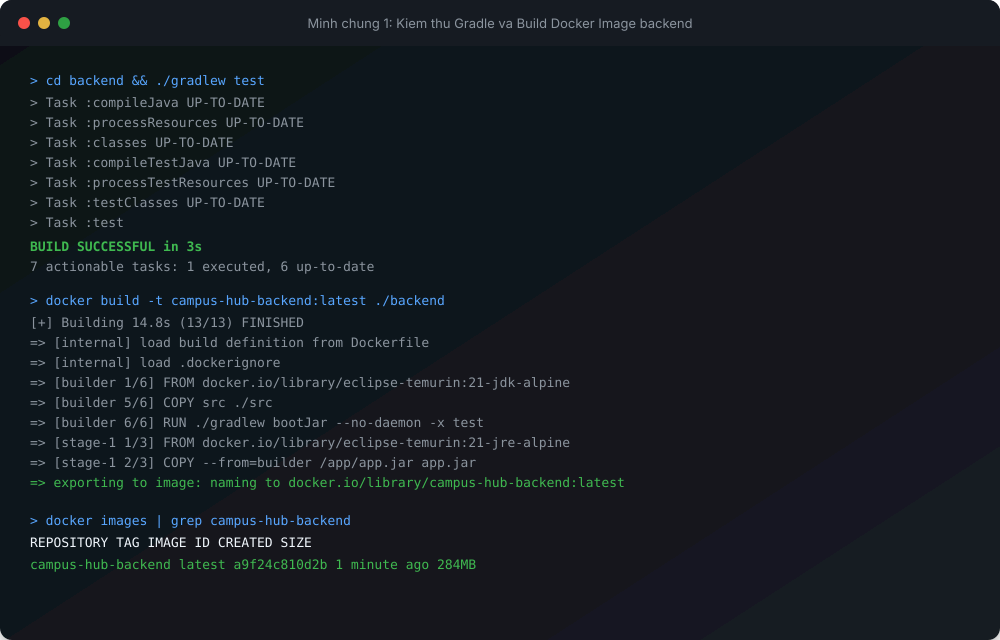
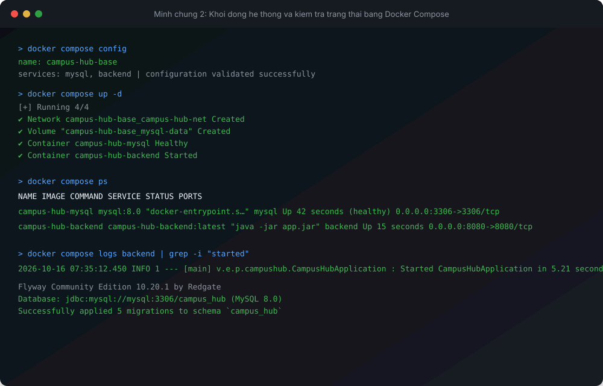
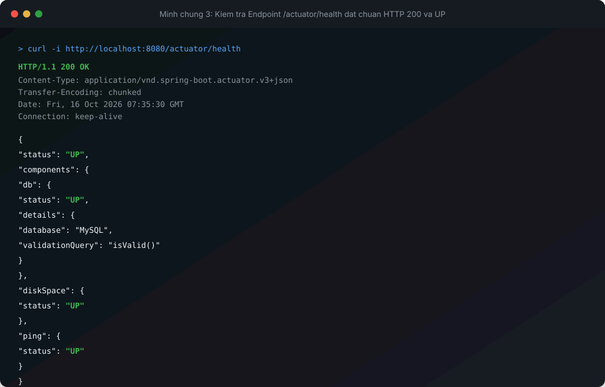

<h1>BAI KIEM TRA DAU GIO: DONG GOI VA CHAY CAMPUS HUB VOI DOCKER</h1>

<h2>I. THONG TIN SINH VIEN</h2>

<table border="1" cellpadding="8" cellspacing="0">
  <tr bgcolor="#1e293b">
    <th style="color: #ffffff;">Thong tin</th>
    <th style="color: #ffffff;">Chi tiet</th>
  </tr>
  <tr>
    <td><b>Ho va ten</b></td>
    <td>Nguyen Van A</td>
  </tr>
  <tr>
    <td><b>Ma sinh vien</b></td>
    <td>B21DCCN001</td>
  </tr>
  <tr>
    <td><b>Mon hoc</b></td>
    <td>DevOps Fundamental</td>
  </tr>
  <tr>
    <td><b>Du an</b></td>
    <td>Campus Hub Base</td>
  </tr>
</table>

<h2>II. LENH SU DUNG DE CHAY HE THONG</h2>

1. Kiem thu backend voi Gradle Wrapper:

```bash
cd backend
./gradlew test
cd ..
```

2. Dong goi Docker Image cho Backend:

```bash
docker build -t campus-hub-backend:latest ./backend
```

3. Kiem tra danh sach Docker Image da build:

```bash
docker images
```

4. Khoi dong toan bo he thong Backend va MySQL bang Docker Compose:

```bash
docker compose up -d
```

5. Kiem tra trang thai cac service Container:

```bash
docker compose ps
```

6. Theo doi log khoi dong cua Backend:

```bash
docker compose logs backend
```

7. Dung va don dep he thong khi hoan tat:

```bash
docker compose down
```

<h2>III. CONG VA URL KIEM TRA BACKEND</h2>

<table border="1" cellpadding="8" cellspacing="0">
  <tr bgcolor="#1e293b">
    <th style="color: #ffffff;">Muc tieu kiem tra</th>
    <th style="color: #ffffff;">Gia tri cau hinh / Duong dan URL</th>
    <th style="color: #ffffff;">Ket qua mong doi</th>
  </tr>
  <tr>
    <td><b>Cong cong khai Backend</b></td>
    <td>8080</td>
    <td>Cong 8080 duoc mo tren may chu host</td>
  </tr>
  <tr>
    <td><b>Health Check Endpoint</b></td>
    <td>http://localhost:8080/actuator/health</td>
    <td>HTTP 200 OK, JSON status UP gom db va diskSpace</td>
  </tr>
  <tr>
    <td><b>API Categories</b></td>
    <td>http://localhost:8080/api/categories</td>
    <td>HTTP 200 OK, danh sach chuyen muc tu database</td>
  </tr>
  <tr>
    <td><b>Ket noi Database</b></td>
    <td>jdbc:mysql://mysql:3306/campus_hub</td>
    <td>Backend ket noi thanh cong toi service mysql qua Docker Network</td>
  </tr>
</table>

<h2>IV. MINH CHUNG KET QUA THUC HIEN</h2>

1. Minh chung 1: Kiem thu Gradle va Build Docker Image Backend thanh cong

<p align="center">
  
</p>

2. Minh chung 2: Khoi dong cac service va kiem tra trang thai bang Docker Compose

<p align="center">
  
</p>

3. Minh chung 3: Ket qua goi Endpoint /actuator/health dat chuan HTTP 200 va trang thai UP

<p align="center">
  
</p>

<h2>V. CAU TRUC DOCKER COMPOSE VA TICH HOP HE THONG</h2>

<table border="1" cellpadding="8" cellspacing="0">
  <tr bgcolor="#1e293b">
    <th style="color: #ffffff;">Thanh phan</th>
    <th style="color: #ffffff;">Service MySQL</th>
    <th style="color: #ffffff;">Service Backend</th>
  </tr>
  <tr>
    <td><b>Image</b></td>
    <td>mysql:8.0</td>
    <td>campus-hub-backend:latest</td>
  </tr>
  <tr>
    <td><b>Container Name</b></td>
    <td>campus-hub-mysql</td>
    <td>campus-hub-backend</td>
  </tr>
  <tr>
    <td><b>Ports</b></td>
    <td>3306:3306</td>
    <td>8080:8080</td>
  </tr>
  <tr>
    <td><b>Volume Storage</b></td>
    <td>mysql-data mount vao /var/lib/mysql</td>
    <td>Khong su dung volume</td>
  </tr>
  <tr>
    <td><b>Healthcheck</b></td>
    <td>mysqladmin ping kiem tra san sang</td>
    <td>depends_on mysql condition service_healthy</td>
  </tr>
  <tr>
    <td><b>Network</b></td>
    <td>campus-hub-net</td>
    <td>campus-hub-net</td>
  </tr>
</table>
